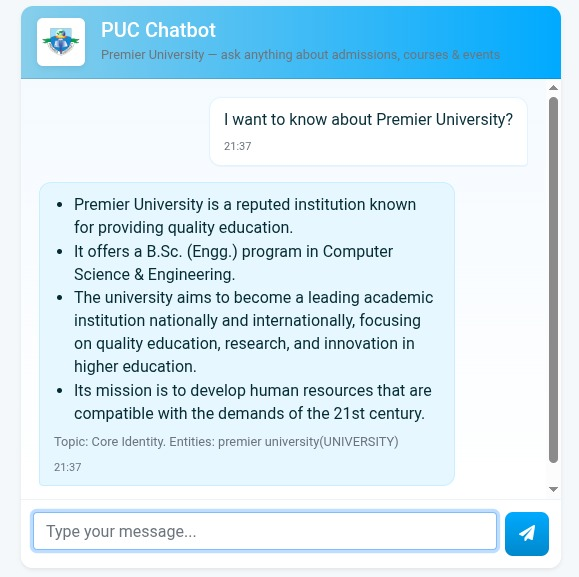
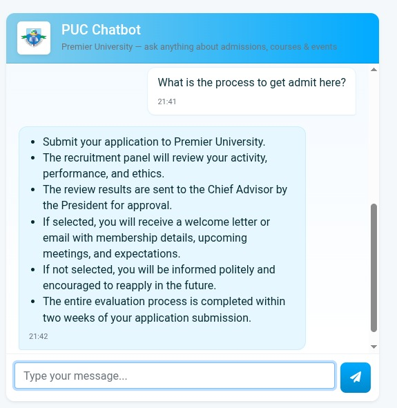
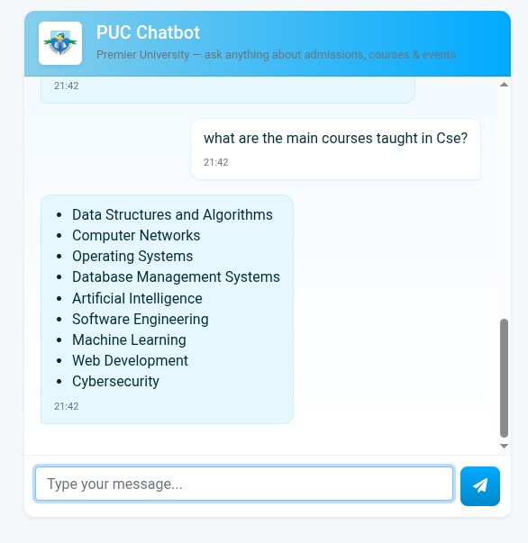
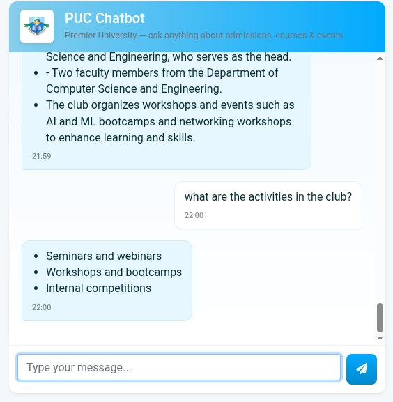
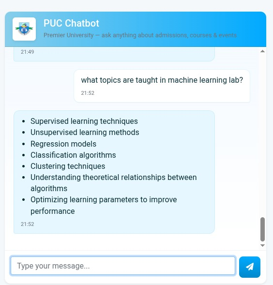
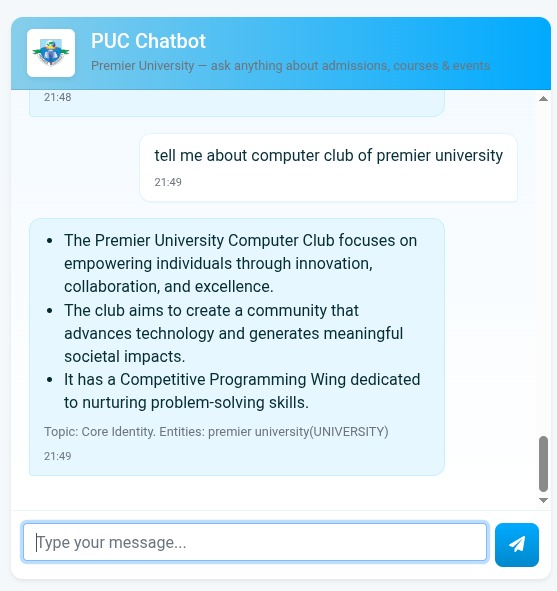
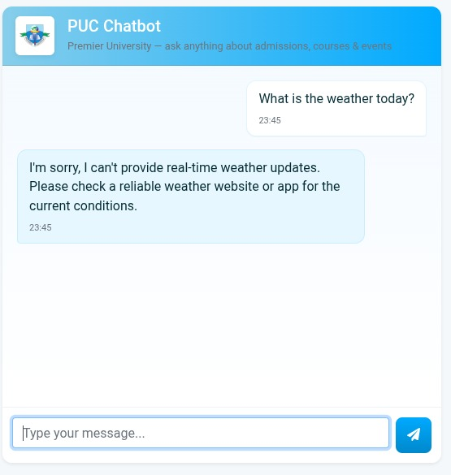
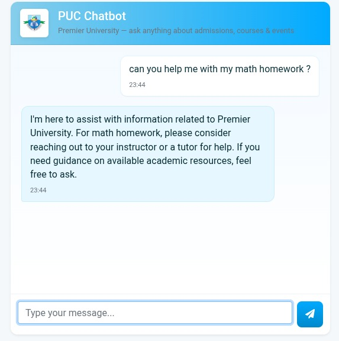

# Premier University Chatbot

A Flask chatbot that uses retrieval-augmented generation (RAG) to answer
questions from university PDF documents. LangChain retrieves relevant document
chunks from Pinecone and sends them to a configurable chat model: Groq or
OpenAI. PDF embeddings are generated locally with a Hugging Face
Sentence Transformers model.

## Requirements

- Python 3.10
- A Pinecone account and API key
- A Groq API key (free tier available) or an OpenAI API key

The Groq free tier has usage limits. Pinecone and the Hugging Face embedding
model are separate from the chat model and are still used by this project.

## Setup

Clone the repository and enter its directory:

```bash
git clone https://github.com/HBSAIKAT/PUC-Chatbot-project-with-LLMs-LangChain-Pinecone-Flask-AWS.git
cd PUC-Chatbot-project-with-LLMs-LangChain-Pinecone-Flask-AWS
```

Create and activate a Python 3.10 Conda environment, then install the
dependencies:

```bash
conda create -n pucbot python=3.10 -y
conda activate pucbot
python -m pip install -r requirements.txt
```


Create a `.env` file in the project root. For Groq, get an API key from
[Groq Console](https://console.groq.com/keys) and configure:

```ini
PINECONE_API_KEY="your-pinecone-api-key"
LLM_PROVIDER="groq"
GROQ_API_KEY="your-groq-api-key"
GROQ_MODEL="llama-3.3-70b-versatile"
```

Groq's free tier has usage limits, and available models can change. Check the
[Groq model list](https://console.groq.com/docs/models) if the example model ID
is no longer available.

Get a Pinecone API key from the [Pinecone Console](https://app.pinecone.io/).
The app expects a Pinecone index named `puc-chatbot` by default. To use a
different index, set `PINECONE_INDEX` in `.env`.

To use OpenAI instead of Groq, set `LLM_PROVIDER="openai"` and provide
`OPENAI_API_KEY`. The model defaults to `gpt-4o`; optionally set `OPENAI_MODEL`.

## Index the PDF documents

Put PDF files in the `data/` directory, then run:

```bash
python store_index.py
```

This creates or updates the Pinecone index using the PDFs in `data/`. You need
to do this before starting the app if the index does not already contain your
documents.

## Run the app

```bash
python app.py
```
## Chatbot UI & Capability Gallery

Here are some examples showing how the bot handles institutional queries about Premier University Chittagong (PUC) alongside its strict scope guardrails for out-of-domain requests:

### 1. Institutional Knowledge & Admissions
| About PUC | Admissions Info | Course List |
| :---: | :---: | :---: |
|  |  |  |

### 2. Academic & Campus Activities
| Club Activities | ML Lab Topics | Computer Club |
| :---: | :---: | :---: |
|  |  |  |

### 3. Scope Boundaries & Guardrails (Out-of-Domain Handling)
*The system correctly restricts responses to PUC-related topics, gracefully deflecting general requests like weather or unrelated homework help:*

| Weather Query (Deflected) | Homework Help (Deflected) |
| :---: | :---: |
|  |  |


Open [http://localhost:8080](http://localhost:8080) in your browser.

## Protect your API keys

Keep credentials in the root `.env` file; `.env` is excluded by `.gitignore`.
Never commit API keys to GitHub or include real credentials in screenshots or
documentation. If a key is exposed, revoke it and create a replacement.

## Tech stack

- Python and Flask
- LangChain
- Groq or OpenAI chat models
- Pinecone vector database
- Hugging Face Sentence Transformers embeddings
